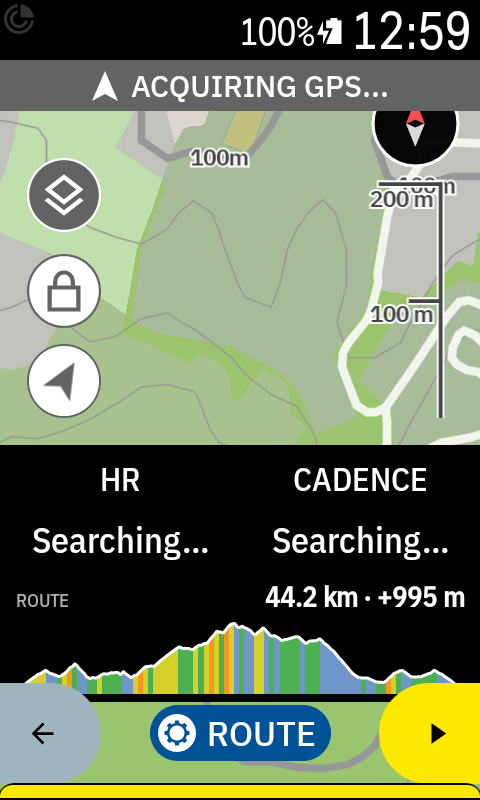
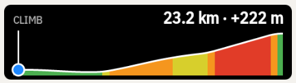
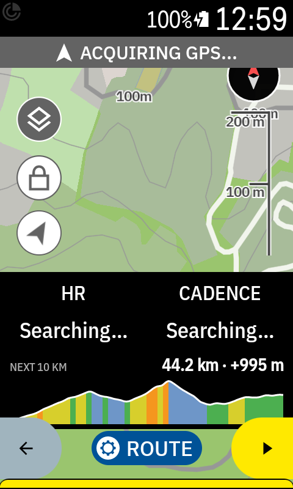
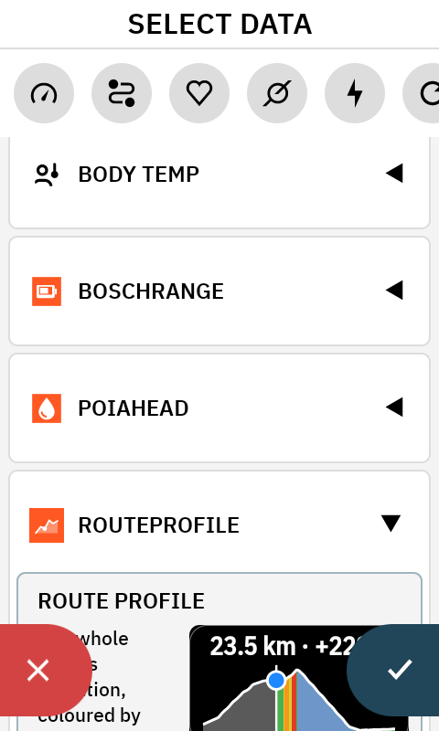
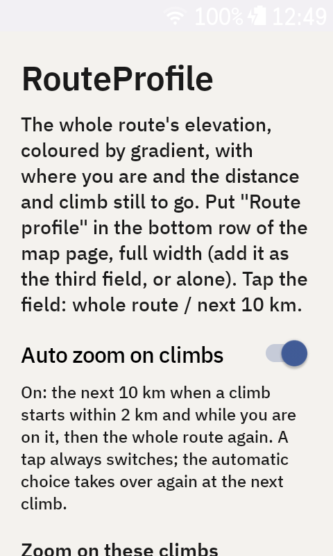

<picture>
  <source media="(prefers-color-scheme: dark)" srcset="https://gist.githubusercontent.com/anpaiss/78cf5eb76ad50594402b9778008a00a8/raw/RouteProfile-card-dark.svg">
  
</picture>

# RouteProfile

> **Version 1.0** — install the APK from the [latest release](../../releases/latest/download/RouteProfile.apk).

The whole route under the map, coloured by gradient, on the Hammerhead Karoo: where you are on it, and how many kilometres and metres of climbing are still to go.

## What it does

RouteProfile adds one data field, **Route profile**, made for the bottom row of the map page: the map keeps most of the screen, the profile of the route you are navigating sits underneath, full width.

- **The whole route**, start to finish. The part you have ridden is grey; the part ahead is coloured by gradient: green below 3 %, yellow 3–6 %, orange 6–9 %, red 9–12 %, dark red from 12 %, blue downhill.
- **Where you are**: a dot and a vertical line.
- **What is left**, top right: kilometres to the end of the route and metres of climbing still to do.
- **Auto zoom on climbs**: when a climb starts within 2 km, and while you are on it, the field shows **that climb across its whole width**, start to top, with a small margin (3 % of its length, at least 50 m): a 2 km ramp and a 15 km pass both fill the cell. While you are still approaching it, the view starts at your position, so you see how far the climb is. The label reads CLIMB; after the top it goes back to the whole route. You choose which climbs (see Settings).
- **Tap the field** to switch between the whole route and the climb when one is near or under you, otherwise the **next 10 km**, with the gradient in 100 m bands. A tap wins until the next climb.
- No route loaded: the field says **No route**.

It reads the route the Karoo is navigating (a route you follow, or a destination the Karoo routes you to) and the Karoo's own position along it; when the Karoo does not give one, the GPS fix is placed on the route line.

## Install

1. Download [`RouteProfile.apk`](../../releases/latest/download/RouteProfile.apk) from the latest release.
2. Sideload it onto the Karoo, for example with `adb install -r RouteProfile.apk`, or with the Hammerhead companion app.
3. In the Karoo profile editor open the **Map Page**, move the fields to the bottom with the arrow, and add **Route profile** (under RouteProfile) as the third field: the third field of the map page takes the whole width. It can also go alone, or on any data page.

It is not on the Hammerhead app store, but once installed it appears in the Karoo **Extensions** library with its description, screenshots and version, and the Karoo checks there for a newer release. The APK is release-signed: new versions install over the old one, settings are kept.

## Settings

Open **RouteProfile** from the Karoo's app list.

- **Auto zoom on climbs**: on by default.
- **Zoom on these climbs**: one switch per climb category. The Karoo lists the climbs of a route but gives them no category, so RouteProfile scores each one as **length in metres × average gradient in %**, as Strava does:

  | Category | Score | Example |
  |---|---|---|
  | Uncategorized | below 8,000 | an overpass, a short ramp (off by default) |
  | Cat 4 | from 8,000 | 1 km at 8 % |
  | Cat 3 | from 16,000 | 2 km at 8 % |
  | Cat 2 | from 32,000 | 4 km at 8 % |
  | Cat 1 | from 64,000 | 8 km at 8 % |
  | HC | from 80,000 | 10 km at 8 % |

- **FIELD PREVIEW**: the field drawn by its own code at the real sizes of the Karoo cells (map page bottom row: whole route, a climb fitted by the auto zoom, the next 10 km; a taller cell, a half cell, no route), with a sample route.

## Technical notes

- The elevation comes from the Karoo's route elevation polyline, which carries the distance along the route: resampled every 50 m, the drawing lightly smoothed (250 m); the climb still to do is counted on the unsmoothed samples.
- The colour bands are about one ninetieth of the window, never under 100 m: 100 m on a climb or the next 10 km, about 500 m on a 45 km route.
- The field is redrawn at most every 2 seconds, as one bitmap the size of its cell.
- Metric units only, for now.

## Is it safe?

- The code is all here, open source.
- `RouteProfile.apk` 1.0 on [VirusTotal](https://www.virustotal.com/gui/file/SHA256_TO_FILL): ENGINES_TO_FILL.
- Its SHA-256 is `SHA256_TO_FILL`; compare it with the file you downloaded (`certutil -hashfile RouteProfile.apk SHA256` on Windows, `sha256sum RouteProfile.apk` elsewhere).
- The APK is built by GitHub Actions from the tagged source, with a signed provenance; each release's notes link its VirusTotal report. Check the provenance with `gh attestation verify RouteProfile.apk -R anpaiss/RouteProfile`.
- It asks for no permission and makes no network call: it only reads what the Karoo shares with extensions.

## Support

RouteProfile is free and open source, and will stay that way. If it made a ride better, you can [buy me a coffee on Ko-fi](https://ko-fi.com/anpaiss).

## License

MIT, see [LICENSE](LICENSE).

If you build on this code, or on its ideas, a mention is much appreciated: a link to this repository is enough.
